## Our Team {.team-slide background-image="figures/background.jpg" background-opacity="0.15"}

::: {.slide-body}
```{r}
#| echo: false
#| include: false
#| eval: false
library(ggplot2)
library(rnaturalearth)
library(sf)

# World map: US teal, France amber, rest grey
world <- ne_countries(scale = "medium", returnclass = "sf")
world$grp <- dplyr::case_when(
  world$sovereignt == "United States of America" ~ "US",
  world$sovereignt == "France" ~ "FR",
  TRUE ~ "other"
)
p_world <- ggplot(world, aes(fill = grp)) +
  geom_sf(color = "#ffffff", linewidth = 0.2) +
  scale_fill_manual(values = c("US" = "#0284c7", "FR" = "#d97706", "other" = "#64748b")) +
  coord_sf(xlim = c(-170, 180), ylim = c(-57, 83)) +
  theme_void() +
  theme(legend.position = "none",
        plot.background = element_rect(fill = "transparent", color = NA))
ggsave("figures/world_map.png", p_world, width = 6, height = 3, dpi = 150, bg = "transparent")

# US map: continental states + starred city locations
us_states <- ne_states(country = "united states of america", returnclass = "sf")
us_cont   <- us_states[!us_states$name %in% c("Alaska", "Hawaii"), ]
cities <- data.frame(
  name      = c("Boston", "Chicago", "Charlottesville", "San Francisco"),
  lon       = c(-71.06,   -87.63,    -78.48,            -122.42),
  lat       = c( 42.36,    41.88,     38.03,               37.77),
  alpha_val = c(1,         1,         1,                   0.25)
)
cities_sf <- st_as_sf(cities, coords = c("lon", "lat"), crs = 4326)
p_us <- ggplot() +
  geom_sf(data = us_cont, fill = "#3b82f6", color = "#1d4ed8", linewidth = 0.35) +
  geom_sf(data = cities_sf, aes(alpha = alpha_val),
          shape = 16, size = 4, color = "#ef4444") +
  scale_alpha_identity() +
  theme_void() +
  theme(plot.background = element_rect(fill = "transparent", color = NA))
ggsave("figures/us_map.png", p_us, width = 6, height = 3.5, dpi = 150, bg = "transparent")
```

```{=html}
<!-- Flex: team diagram (left, ~75%) | maps (right, ~25%) -->
<div style="display:flex;align-items:center;justify-content:center;gap:35px;width:100%;">

  <!-- Left: team spoke diagram scaled 87% (960×540 → 835×470) -->
  <div style="flex:0 0 710px;height:515px;font-size:28px;overflow:hidden;position:relative;">
    <div style="position:absolute;top:0;left:0;width:960px;height:540px;transform:translateY(28px) scale(0.74);transform-origin:top left;">

      <svg style="position:absolute;inset:0;width:100%;height:100%;z-index:1;" viewBox="0 0 960 540">
        <line x1="480" y1="252" x2="480" y2="125" stroke="#1a6f8f" stroke-width="2.5" stroke-dasharray="8,5" opacity="0.5"/>
        <line x1="585" y1="277" x2="771" y2="227" stroke="#1a6f8f" stroke-width="2.5" stroke-dasharray="8,5" opacity="0.5"/>
        <line x1="573" y1="358" x2="683" y2="435" stroke="#1a6f8f" stroke-width="2.5" stroke-dasharray="8,5" opacity="0.5"/>
        <line x1="387" y1="358" x2="277" y2="435" stroke="#1a6f8f" stroke-width="2.5" stroke-dasharray="8,5" opacity="0.5"/>
        <line x1="375" y1="277" x2="184" y2="225" stroke="#b86f00" stroke-width="2.5" stroke-dasharray="8,5" opacity="0.5"/>
      </svg>

      <div style="position:absolute;top:305px;left:480px;transform:translate(-50%,-50%);width:220px;text-align:center;background:#dff0f7;border:2.5px solid #1a6f8f;border-radius:14px;padding:11px 16px;z-index:2;">
        <div style="font-weight:700;color:#1a6f8f;font-size:0.9em;line-height:1.3;">Modeling, Simulation &amp; High Performance Computing</div>
        <div style="font-size:0.75em;color:#666;margin-top:5px;">Argonne National Laboratory</div>
      </div>

      <div style="position:absolute;top:-35px;left:395px;width:170px;text-align:center;z-index:2;">
        <div style="background:#eef6fa;border:1.5px solid #1a6f8f;border-radius:10px;padding:9px 11px;">
          
          <div style="font-weight:700;color:#0d485e;font-size:0.9em;">Jonathan Ozik</div>
          <div style="font-size:0.74em;color:#555;">Team Lead</div>
        </div>
      </div>

      <div style="position:absolute;top:143px;left:756px;width:180px;text-align:center;z-index:2;">
        <div style="background:#eef6fa;border:1.5px solid #1a6f8f;border-radius:10px;padding:9px 11px;">
          
          <div style="font-weight:700;color:#0d485e;font-size:0.9em;">Nicholson Collier</div>
          <div style="font-size:0.74em;color:#555;">Software Engineer</div>
        </div>
      </div>

      <div style="position:absolute;top:410px;left:668px;width:170px;text-align:center;z-index:2;">
        <div style="background:#eef6fa;border:1.5px solid #1a6f8f;border-radius:10px;padding:9px 11px;">
          
          <div style="font-weight:700;color:#0d485e;font-size:0.9em;">David O'Gara</div>
          <div style="font-size:0.74em;color:#555;">Computational Statistician</div>
        </div>
      </div>

      <div style="position:absolute;top:410px;left:122px;width:170px;text-align:center;z-index:2;">
        <div style="background:#eef6fa;border:1.5px solid #1a6f8f;border-radius:10px;padding:9px 11px;">
          
          <div style="font-weight:700;color:#0d485e;font-size:0.9em;">Arindam Fadikar</div>
          <div style="font-size:0.74em;color:#555;">Computational Statistician</div>
        </div>
      </div>

      <div style="position:absolute;top:143px;left:24px;width:175px;text-align:center;z-index:2;">
        <div style="background:#fdf5e6;border:1.5px dashed #b86f00;border-radius:10px;padding:9px 11px;">
          
          <div style="font-weight:700;color:#0d485e;font-size:0.9em;">Mickael Binois</div>
          <div style="font-size:0.74em;color:#555;">Outside Collaborator</div>
          <div style="font-size:0.75em;color:#b86f00;margin-top:2px;">Inria</div>
        </div>
      </div>

    </div>
  </div>

  <!-- Right: world map (top) + US map (bottom), no headings, transparent bg -->
  <div style="flex:0 1 520px;min-width:0;display:flex;flex-direction:column;align-items:center;gap:24px;">
    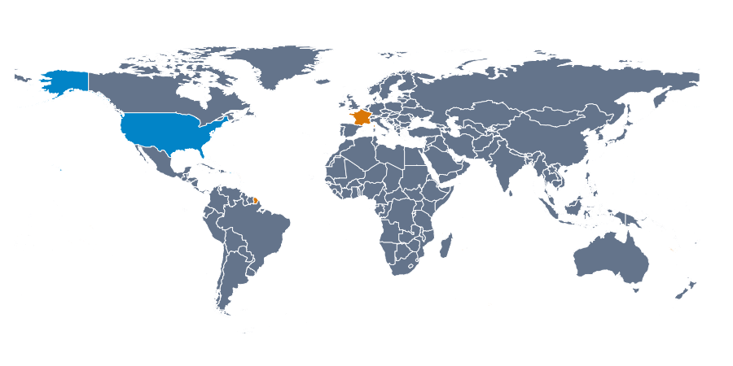
    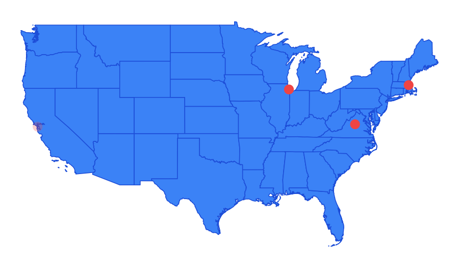
  </div>

</div>
```

:::


## Our Setting {.workflow-slide}

::: {.slide-body}
::: {style="font-size:1em;color:#0d485e;margin:0 0 16px;"}
Simulation-based inference supports policy analysis under uncertainty.
:::

```{=html}
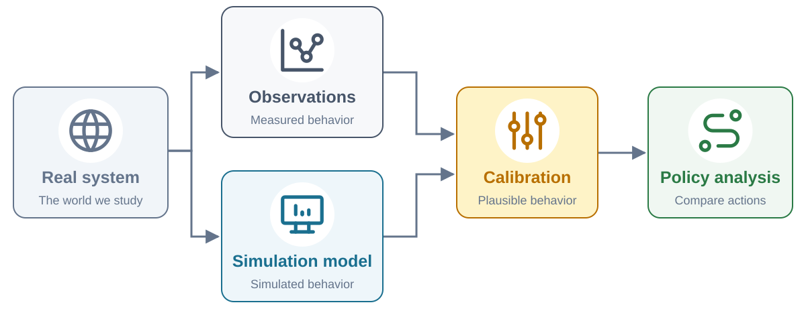
```


::: {style="text-align:center;font-size:1.05em;margin-top:16px;"}
Calibration shapes the futures we carry into policy analysis.
:::

::: {style="font-size:0.43em;color:#64748b;margin-top:10px;"}
Icon sources: [world](https://github.com/tabler/tabler-icons/blob/main/icons/outline/world.svg), [chart-dots](https://github.com/tabler/tabler-icons/blob/main/icons/outline/chart-dots.svg), [desktop-analytics](https://github.com/tabler/tabler-icons/blob/main/icons/outline/device-desktop-analytics.svg), [adjustments](https://github.com/tabler/tabler-icons/blob/main/icons/outline/adjustments.svg), [route](https://github.com/tabler/tabler-icons/blob/main/icons/outline/route.svg) — Tabler Icons, Paweł Kuna; [MIT license](https://github.com/tabler/tabler-icons/blob/main/LICENSE). Adapted colors and size.
:::

:::

::: notes
Our setting is simulation-based inference and policy analysis. We use observations to constrain plausible model behavior, then explore how policies perform across uncertain futures. Calibration is one part of that workflow: future scenarios and model structure also matter. The question for this talk is how the calibration search affects which data-consistent behaviors we carry forward. The next slide illustrates why this matters for future uncertainty.
:::

## Calibration {.workflow-slide}

::: {.slide-body}
::: {style="font-size:1em;color:#0d485e;margin:0 0 16px;"}
Our focus: constrain simulation behavior using observations.
:::

```{=html}
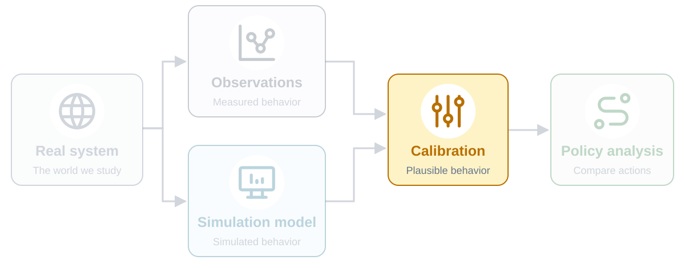
```


::: {style="text-align:center;font-size:1.05em;margin-top:16px;"}
Calibration shapes the futures we carry into policy analysis.
:::

::: {style="font-size:0.43em;color:#64748b;margin-top:10px;"}
Icon sources: [world](https://github.com/tabler/tabler-icons/blob/main/icons/outline/world.svg), [chart-dots](https://github.com/tabler/tabler-icons/blob/main/icons/outline/chart-dots.svg), [desktop-analytics](https://github.com/tabler/tabler-icons/blob/main/icons/outline/device-desktop-analytics.svg), [adjustments](https://github.com/tabler/tabler-icons/blob/main/icons/outline/adjustments.svg), [route](https://github.com/tabler/tabler-icons/blob/main/icons/outline/route.svg) — Tabler Icons, Paweł Kuna; [MIT license](https://github.com/tabler/tabler-icons/blob/main/LICENSE). Adapted colors and size.
:::

:::

::: notes
Calibration is the focus of this talk. Observations and simulated behavior meet here, constraining which model realizations we carry forward into policy analysis. The other parts of the workflow remain important; the faded blocks emphasize the scope of this work.
:::

## Calibration Shapes Decision Uncertainty

::: {.slide-body}
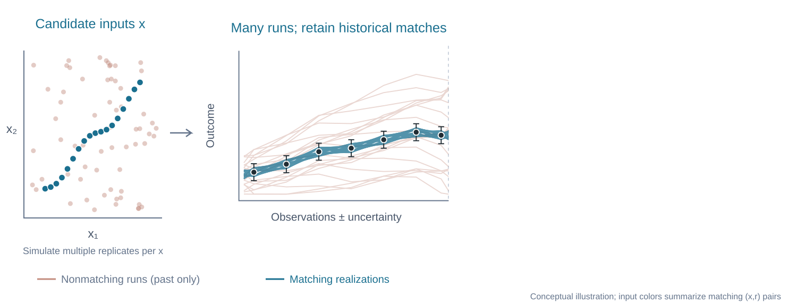{width="100%" fig-alt="A candidate input-space panel accompanies historical simulations: pale terracotta runs do not match observations; eighteen blue matching realizations continue into diverse futures."}

::: {style="text-align:center;font-size:1.15em;margin-top:18px;"}
[Search candidate inputs]{.hl-blue} → [Retain historical matches]{.hl-amber}
:::

:::

::: notes
Start with candidate inputs and stochastic replicates. Many runs do not match the observed history; retain the compatible input–replicate pairs. The future is deliberately hidden until the next slide, which reveals it without moving the figure.
:::

## Calibration Shapes Decision Uncertainty

::: {.slide-body}
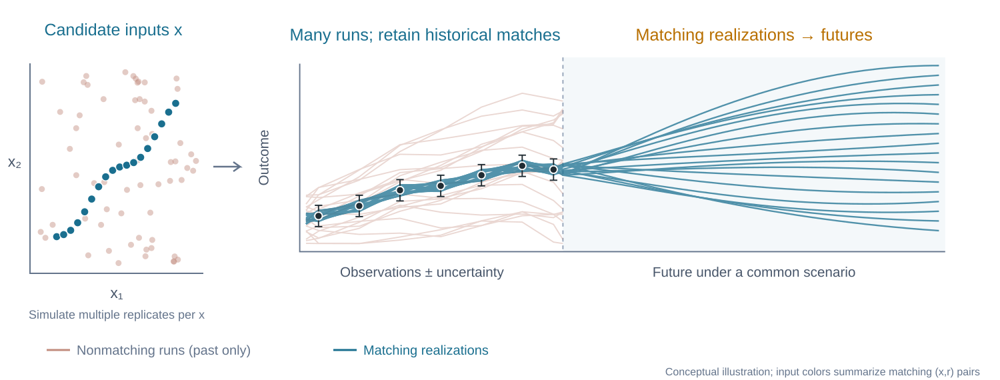{width="100%" fig-alt="A candidate input-space panel accompanies historical simulations: pale terracotta runs do not match observations; eighteen blue matching realizations continue into diverse futures."}

::: {style="text-align:center;font-size:1.15em;margin-top:18px;"}
[Calibrate to observations]{.hl-blue} → [Propagate uncertainty]{.hl-amber} → [Stress-test decisions]{.hl-green}
:::

:::

::: notes
A stochastic model can reproduce the observed history in several ways. Compatible parameter values and stochastic realizations can produce different future outcomes under the same scenario. Calibration determines which possibilities we carry forward, and how we represent them; it does not remove uncertainty about future conditions or model structure. If we retain only a best fit or an average trajectory, we can miss threshold crossings that matter for decisions. For DMDU, the connection is to stress-testing actions across plausible futures. The figure is conceptual, not a forecast or a calibrated probability distribution.
:::

## Stochastic Simulation

::: {.slide-body}
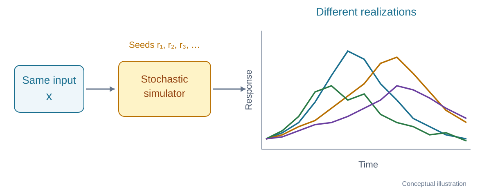{width="100%" fig-alt="A fixed input x enters a stochastic simulator. Different random seeds produce different output trajectories."}

::: {style="text-align:center;font-size:1.1em;margin-top:12px;"}
$y(t) = f(x, r; t)$ — [Fixed input $x$]{.hl-blue}, [different random seeds $r$]{.hl-amber}
:::

:::

::: notes
A stochastic simulator contains random events. Holding the model inputs x fixed, independent replicates can produce different time series. Here r denotes the random seed identifying a realization; a replicate is one run at that input. With x and the seed fixed, the simulator is reproducible. The curves are conceptual realizations, not fitted data.
:::

## Missed Matches

::: {.slide-body}
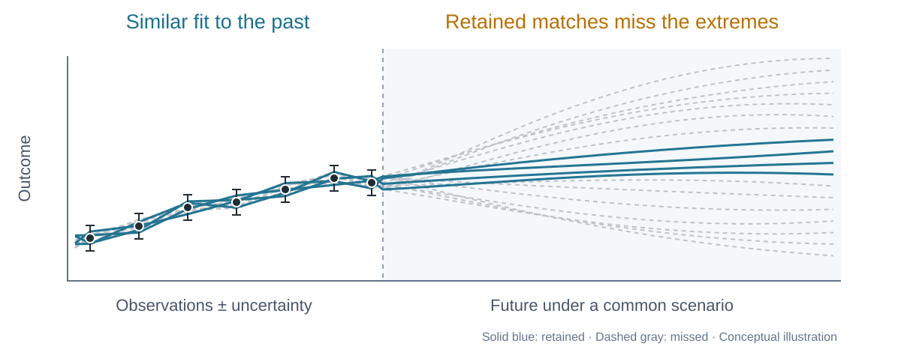{width="100%" fig-alt="Candidate inputs and nonmatching historical simulations accompany eighteen compatible trajectories. Four matches are retained in blue; missed matches are dashed gray, showing omitted plausible futures."}

::: {style="text-align:center;font-size:1.1em;margin-top:12px;"}
[Miss relevant $(x, r)$ matches]{.hl-red} → [Miss plausible futures]{.hl-amber}
:::

:::

::: notes
Return to the earlier illustration. Pale terracotta points and historical paths represent nonmatching candidates. The blue and dashed gray paths represent input–replicate pairs compatible with the historical observation error bars. The input panel is a conceptual two-dimensional projection; matching is assessed for each (x,r) pair, not for x alone. Suppose our search finds only the four central paths. Their future spread appears narrow, while omitted matches include more extreme future outcomes. Missing relevant matches can distort the propagated uncertainty and affect decisions. This is a coverage argument: finding all compatible paths alone does not assign calibrated probabilities, and futures must also account for scenario and model uncertainty. The example is conceptual.
:::

## Finding Matches

::: {.slide-body}
::: {style="width:100%;"}


::: {.columns}
::: {.column width="52%"}
### Search over inputs **and** replicates

$$y(t) = f(x, r; t)$$

Keep pairs whose histories match the observations:

$$\mathcal{A}_{\delta} = \left\{(x,r): d\!\left(f(x,r), y_{\mathrm{obs}}\right) \leq \delta\right\}$$

[Many compatible paths]{.hl-blue}, rather than one best fit.
:::
::: {.column width="48%"}
### The computational challenge

- Many inputs $x$
- Many replicates $r$
- [Limited simulation budget]{.hl-red}

::: {.highlight-box}
**Which $(x,r)$ should we run next?**
:::
:::
:::

<!-- ::: {style="text-align:center;font-size:1.1em;margin-top:35px;"}
[Discover historical matches]{.hl-blue} → [Carry their futures forward]{.hl-amber}
::: -->


:::

:::

::: notes
The previous slide showed the consequence of missing compatible runs. This changes the computational target: search for a collection of input–replicate pairs whose simulated histories are consistent with the observations, rather than only a parameter vector with a good mean response. Here x denotes model parameters and r identifies a random realization. The discrepancy d compares the historical portion only; its definition and tolerance delta should reflect observational uncertainty and the intended calibration criterion. With expensive simulations, exhaustive search is infeasible, so the next-run choice matters. This motivates trajectory discovery under a finite budget. The accepted collection supports coverage of compatible futures; it is not automatically a posterior sample or a probability-weighted forecast.
:::

## What Existing Methods Lack

::: {.slide-body}
::: {style="width:100%;"}


::: {.columns}
::: {.column width="50%"}
[**Approximate Bayesian Computation**]{.hl-blue}

- Simulate, compare to data via summary statistics
- Accept/reject based on distance threshold
- [**Potential gap:**]{.hl-red} compressed summaries can discard trajectory-level information
:::
::: {.column width="50%"}
[**Mean-based Emulation + Calibration**]{.hl-blue}

- Build a surrogate of $\mathbb{E}[f(x,r)]$
- Optimize over $x$
- [**Gap:**]{.hl-red} averaging before emulation loses replicate-specific behavior
:::
:::

::: {.callout}
Mean-based methods [aggregate over randomness]{.hl-red}. A good mean fit does not identify data-consistent realizations.
:::

**The consequence:** the search targets the mean response, rather than explicitly discovering compatible $(x,r)$ pairs.
:::

:::


## What Existing Methods Lack

::: {.slide-body}
::: {style="font-size:1.15em;margin:15px 0 10px;"}
Mean-based calibration [aggregates over randomness]{.hl-red} before searching.
:::

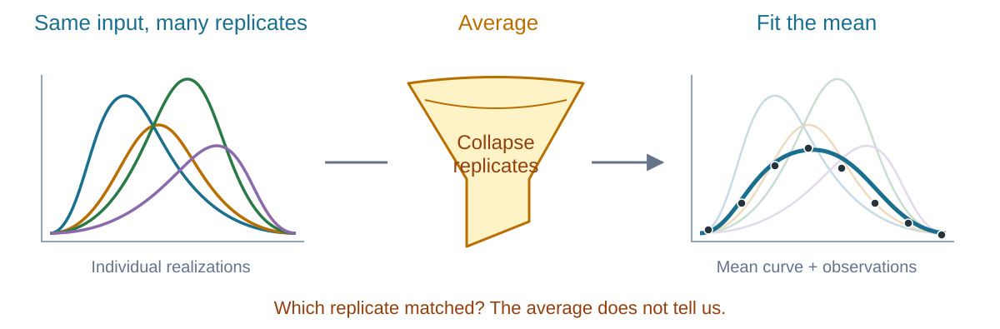{width="100%" fig-alt="Conceptual cartoon: several differently timed stochastic trajectories enter an averaging funnel. A single mean curve emerges and is compared with observations, hiding which individual realizations match."}

::: {style="text-align:center;font-size:1.1em;margin-top:15px;"}
[A good mean fit]{.hl-blue} does not identify [which realizations fit]{.hl-amber}.
:::

:::

::: notes
This cartoon describes approaches that emulate and calibrate the mean response. At a fixed input, replicates can have different timing and shape. Averaging collapses that variation before the search. A good fit of the mean does not tell us which individual input–replicate pairs reproduce the observed history. The limitation is about the search target, not a claim that every calibration method ignores randomness. ABC can use full trajectories or informative summaries; stochastic likelihood methods can explicitly represent variability. Our aim is to discover compatible realizations directly. The illustration is conceptual; it does not imply that a mean can never be realized.
:::

## Our Contribution {.body-near-title}

::: {.slide-body}
::: {style="text-align:center;font-size:1.4em;color:#0d485e;margin:30px 0 45px;"}
**Trajectory-Oriented Optimization (TOO)**
:::

```{=html}
<div style="display:flex;gap:28px;max-width:100%;margin:0 auto;">
  <div style="flex:1;text-align:center;padding:28px 20px;background:#eef6fa;border:2px solid #1a6f8f;border-radius:14px;color:#1a6f8f;font-size:1.15em;font-weight:600;">
    Replicate-aware<br>surrogate
    <div style="text-align:left;font-size:0.85em;font-weight:400;line-height:1.65;margin-top:24px;border-top:1px solid #b7d5e0;padding-top:18px;">
      <div>• Learn individual realizations</div>
      <div>• Share information across replicates</div>
      <div>• Predict untried (<i>x</i>, <i>r</i>) pairs</div>
    </div>
  </div>
  <div style="flex:1;text-align:center;padding:28px 20px;background:#fff5e6;border:2px solid #b86f00;border-radius:14px;color:#92400e;font-size:1.15em;font-weight:600;">
    Adaptive grid<br>Thompson sampling
    <div style="text-align:left;font-size:0.85em;font-weight:400;line-height:1.65;margin-top:24px;border-top:1px solid #e9cfaa;padding-top:18px;">
      <div>• Explore promising regions</div>
      <div>• Refine candidate locations</div>
      <div>• Select simulations in batches</div>
    </div>
  </div>
</div>
```

:::

::: notes
Our contribution is trajectory-oriented optimization, or TOO. It brings together two main ingredients: a replicate-aware surrogate and adaptive grid Thompson sampling. Together they target the discovery of data-consistent input–replicate pairs under a limited simulation budget. The following slides will introduce each ingredient.
:::

## Replicate-Aware Surrogate {.surrogate-slide}

::: {.slide-body}
[**Common Random Number Gaussian Process (CRNGP)**]{.hl-blue}

A surrogate for individual realizations, indexed by input $x$ and replicate $r$:

$$f(x,r) \sim \mathrm{GP}\!\left(m(x,r),\; k\bigl((x,r),(x',r')\bigr)\right)$$

::: {.columns .method-panels}
::: {.column width="52%"}
### Shared structure {.hl-blue}

$$k\bigl((x,r),(x',r')\bigr)
= k_x(x,x')\,k_r(r,r')$$

- Learn how responses vary with $x$
- [Borrow information across replicates]{.hl-blue}
:::
::: {.column width="48%"}
### Replicate-specific predictions {.hl-amber}

$$f(x,r)\mid\mathcal{D}
\sim \mathcal{N}\!\left(\mu(x,r),\sigma^2(x,r)\right)$$

- Predict each realization's response
- [Quantify surrogate uncertainty]{.hl-amber} at untried $(x,r)$
:::
:::

:::

::: notes
CRNGP is a Gaussian process surrogate that keeps the replicate identity as an explicit input. Here f is a scalar simulator response or calibration objective for an input–replicate pair. The covariance has an input component and a replicate component, allowing information to be shared without averaging away the individual realizations. The seed labels are categorical identities, not a numerical distance: nearby seed numbers are not assumed to produce similar outputs. Given evaluated simulations D, the surrogate predicts a mean and uncertainty for an untried pair. This uncertainty describes our incomplete knowledge of the simulator response; it is distinct from the spread of future system outcomes across compatible realizations. Details of the replicate kernel are in the backup slides.
:::


## CRNGP in Practice

::: {.slide-body}
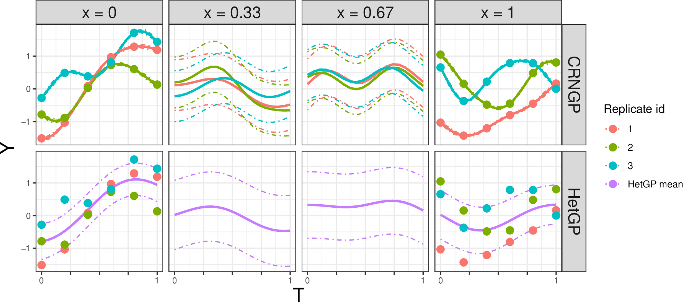{width="95%"}

:::


## Adaptive Grid Thompson Sampling {.sampling-slide .body-near-title}

::: {.slide-body}
::: {style="width:100%;"}

::: {style="margin-bottom:90px;"}
**Choose the next batch of $(x,r)$ pairs; refine where we search.**
:::

::: {.columns .method-panels .sampling-panels}
::: {.column width="33%"}
### Sample {.hl-blue}

* Fit/update surrogate based on $f_n = \{ f(x_1, r_1), \ldots, f(x_n, r_n) \}$. 
* Draw plausible response from the CRNGP posterior at many $(x_b,r_b)$:

$$\widetilde{f}(x_i,r_i) \sim p(f\mid\mathcal{f}_n)$$
:::
::: {.column width="34%"}
### Select & simulate {.hl-orange}

* Each draw proposes a promising pair from the grid $\mathcal{G}_n$.
$$ (x_b,r_b)= \\ \arg\min_{(x,r)\in\mathcal{G}_n}
| \widetilde{f}_(x,r) - y_{\text{obs}} | $$
* Run new simulation at $(x_b,r_b)$ 
* Update CRNGP surrogate
:::
::: {.column width="33%"}
### Adapt {.hl-green}

* Refine the candidate grid:

$$\mathcal{G}_n \longrightarrow \mathcal{G}_{n+1}$$

Concentrate and add candidates near promising regions.
:::
:::

<!-- ::: {style="text-align:center;font-size:1.1em;margin-top:35px;"}
[Explore uncertain possibilities]{.hl-blue} + [refine promising regions]{.hl-amber}
::: -->

:::

:::

::: notes
We search for small historical discrepancy D over a finite candidate grid G of input–replicate pairs. D_n denotes the completed simulator evaluations. Thompson sampling draws plausible discrepancy surfaces from the surrogate posterior; a minimizer of each draw proposes a simulation, with duplicate selections handled when forming the batch. After evaluating the batch, update the surrogate and adapt the candidate grid by filtering and densifying promising regions. This combines uncertainty-driven exploration with local refinement under a fixed simulation budget. These posterior draws concern uncertainty in the surrogate discrepancy surface, not posterior samples of calibrated parameters or future outcomes. Detailed grid adaptation is in the backup slides.
:::

## Fixed Grid Thompson Sampling

::: {.slide-body}
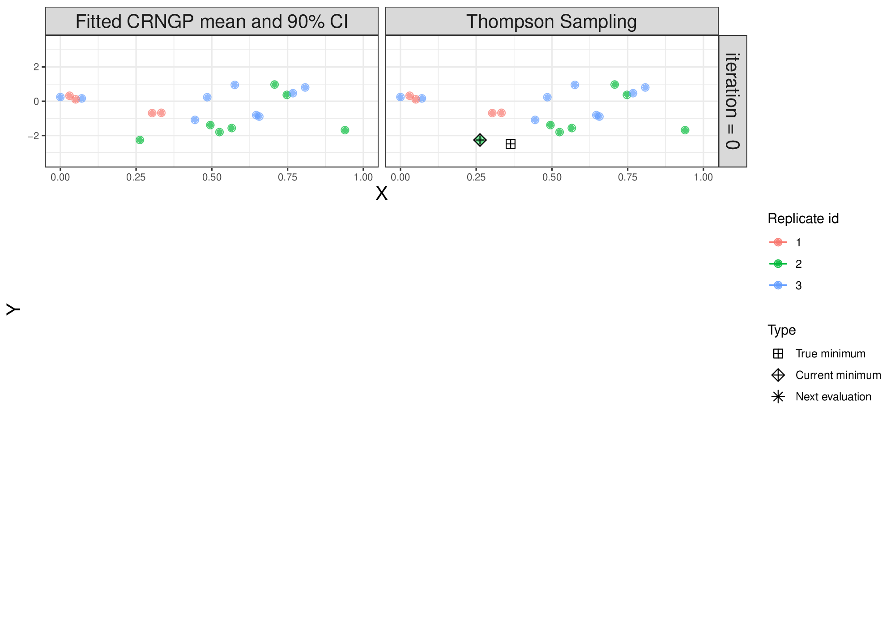{width="95%" fig-align="center"}

:::

## Fixed Grid Thompson Sampling

::: {.slide-body}
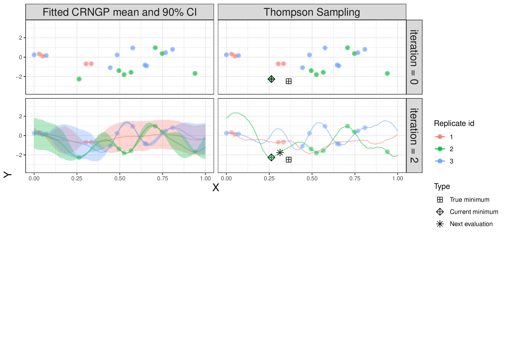{width="95%" fig-align="center"}

:::

## Fixed Grid Thompson Sampling

::: {.slide-body}
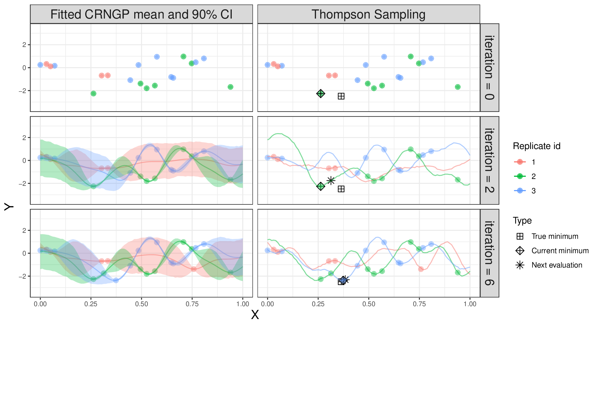{width="95%" fig-align="center"}

:::

## Fixed Grid Thompson Sampling

::: {.slide-body}
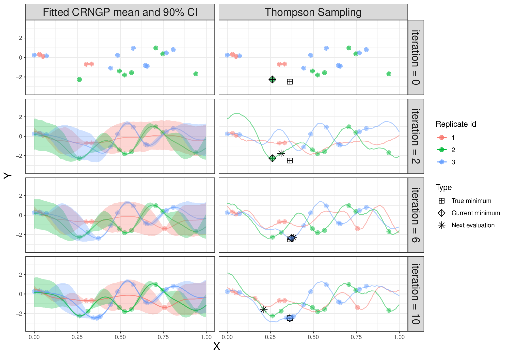{width="95%" fig-align="center"}

:::


## Adaptive Grid Thompson Sampling

::: {.slide-body}
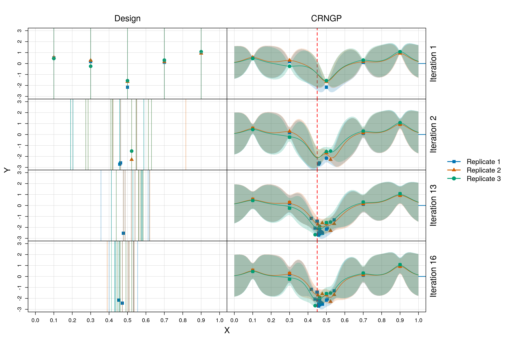{width="95%" fig-align="center"}

:::


## Result - Matching Trajectories

::: {.slide-body}
Stochastic SIR: multiple realizations reproduce the observed infection curve.

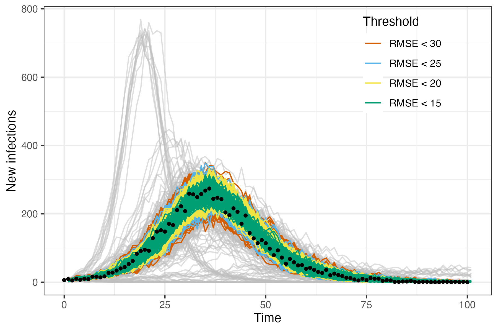{width="95%" fig-align="center"}

:::


## Result - Exploring Inputs

::: {.slide-body}
aCRN explores an extended region of infection and recovery rates.

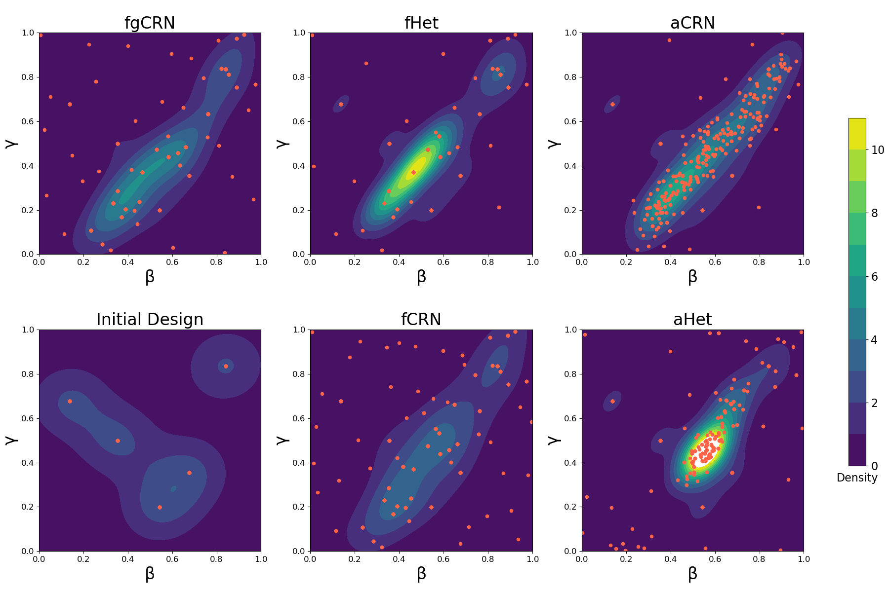{width="95%" fig-align="center"}

:::


## Summary {.plain-summary}

::: {.slide-body}
- **Calibration matters downstream.** Missed historical matches can mean missed plausible futures.

- **Search for realizations.** TOO targets compatible $(x,r)$ pairs, rather than only a mean response.

- **Adaptive optimization approach.** aCRN combines a replicate-aware surrogate with adaptive grid Thompson sampling.

- **DMDU relevance:** carry diverse, data-consistent behaviors forward to stress-test policies across plausible futures.

```{=html}
<div style="display:flex;align-items:center;gap:25px;margin:20px 0 0 0;">
  <div style="flex:1;color:#222;font-size:0.85em;line-height:1.45;">
    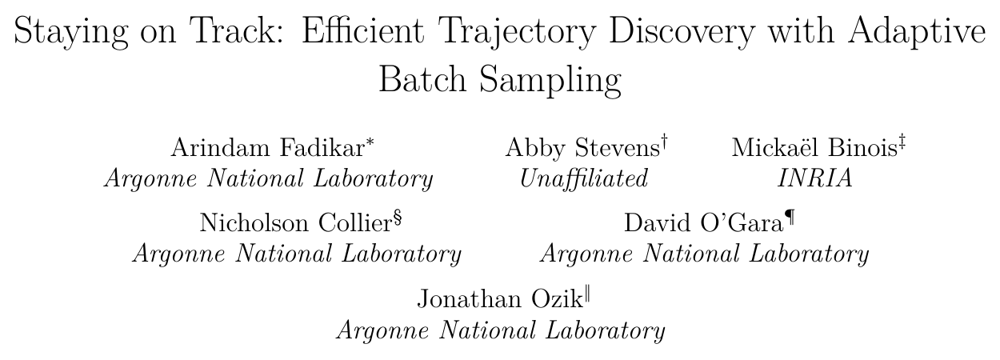
    Preprint: <a href="https://arxiv.org/abs/2510.18099" style="color:#222;text-decoration:underline;">arXiv:2510.18099</a>
  </div>
  <a href="https://arxiv.org/abs/2510.18099" style="flex:0 0 250px;margin-right:10px;">
    
  </a>
</div>
```

:::

::: notes
The DMDU connection is coverage: the historical behaviors retained by calibration shape the futures available for policy stress-testing. TOO explicitly searches over inputs and replicates. Our aCRN approach combines CRNGP with adaptive grid Thompson sampling to make that search practical under a simulation budget. Diverse historical matches support exploration of plausible futures; they do not automatically define calibrated future probabilities. Scenario and model uncertainty also remain important. The preprint provides the method and experimental details.
:::

<!-- Backup slides are preserved in backup-slides.qmd.disabled.
They are excluded from rendering so the presentation ends at Summary. -->
