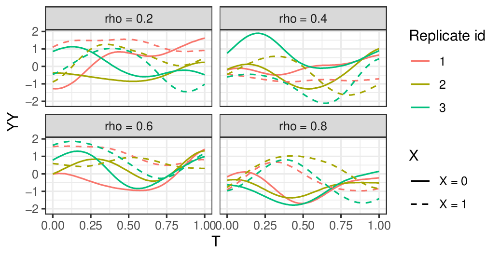
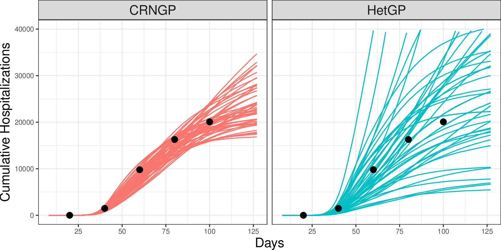
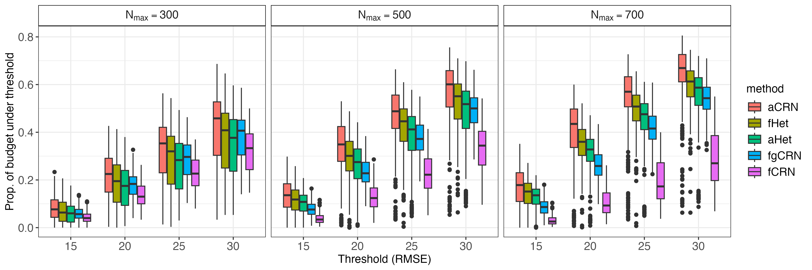
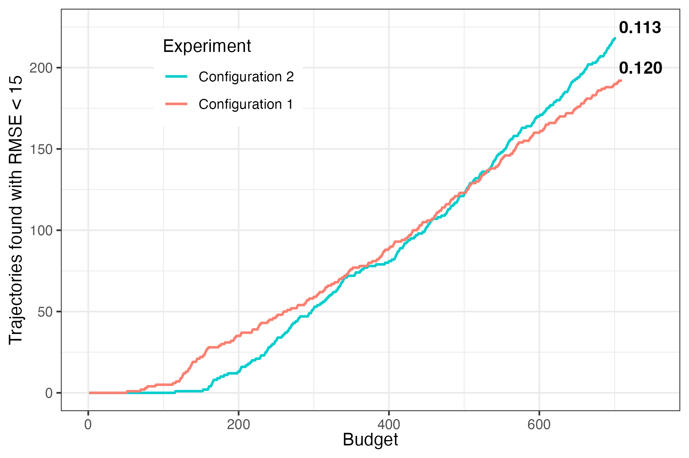
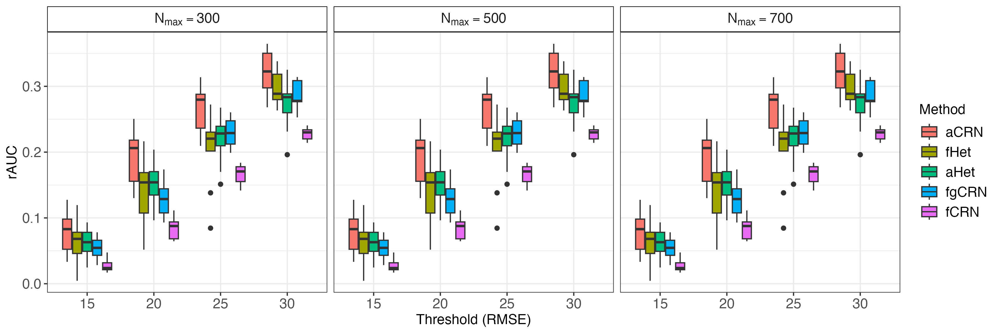
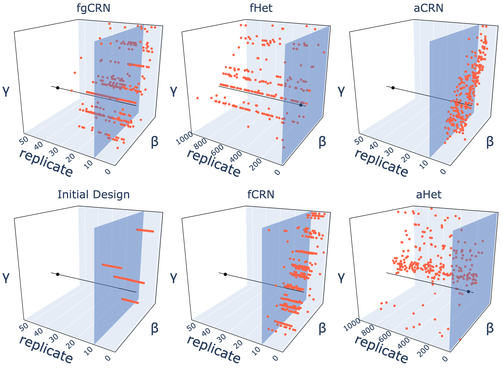

## Our Team {background-image="figures/background.jpg" background-opacity="0.15"}

```{r}
#| echo: false
#| include: false
#| eval: false
library(ggplot2)
library(rnaturalearth)
library(sf)

# World map: US teal, France amber, rest grey
world <- ne_countries(scale = "medium", returnclass = "sf")
world$grp <- dplyr::case_when(
  world$sovereignt == "United States of America" ~ "US",
  world$sovereignt == "France" ~ "FR",
  TRUE ~ "other"
)
p_world <- ggplot(world, aes(fill = grp)) +
  geom_sf(color = "#ffffff", linewidth = 0.2) +
  scale_fill_manual(values = c("US" = "#0284c7", "FR" = "#d97706", "other" = "#64748b")) +
  coord_sf(xlim = c(-170, 180), ylim = c(-57, 83)) +
  theme_void() +
  theme(legend.position = "none",
        plot.background = element_rect(fill = "transparent", color = NA))
ggsave("figures/world_map.png", p_world, width = 6, height = 3, dpi = 150, bg = "transparent")

# US map: continental states + starred city locations
us_states <- ne_states(country = "united states of america", returnclass = "sf")
us_cont   <- us_states[!us_states$name %in% c("Alaska", "Hawaii"), ]
cities <- data.frame(
  name      = c("Boston", "Chicago", "Charlottesville", "San Francisco"),
  lon       = c(-71.06,   -87.63,    -78.48,            -122.42),
  lat       = c( 42.36,    41.88,     38.03,               37.77),
  alpha_val = c(1,         1,         1,                   0.25)
)
cities_sf <- st_as_sf(cities, coords = c("lon", "lat"), crs = 4326)
p_us <- ggplot() +
  geom_sf(data = us_cont, fill = "#3b82f6", color = "#1d4ed8", linewidth = 0.35) +
  geom_sf(data = cities_sf, aes(alpha = alpha_val),
          shape = 16, size = 4, color = "#ef4444") +
  scale_alpha_identity() +
  theme_void() +
  theme(plot.background = element_rect(fill = "transparent", color = NA))
ggsave("figures/us_map.png", p_us, width = 6, height = 3.5, dpi = 150, bg = "transparent")
```

```{=html}
<!-- Flex: team diagram (left, ~75%) | maps (right, ~25%) -->
<div style="display:flex;align-items:flex-start;gap:20px;">

  <!-- Left: team spoke diagram scaled 87% (960×540 → 835×470) -->
  <div style="flex:0 0 835px;height:520px;overflow:hidden;position:relative;">
    <div style="position:absolute;top:0;left:0;width:960px;height:540px;transform:scale(0.87);transform-origin:top left;">

      <svg style="position:absolute;inset:0;width:100%;height:100%;z-index:1;" viewBox="0 0 960 540">
        <line x1="480" y1="252" x2="480" y2="165" stroke="#1a6f8f" stroke-width="2.5" stroke-dasharray="8,5" opacity="0.5"/>
        <line x1="585" y1="277" x2="771" y2="227" stroke="#1a6f8f" stroke-width="2.5" stroke-dasharray="8,5" opacity="0.5"/>
        <line x1="573" y1="358" x2="633" y2="392" stroke="#1a6f8f" stroke-width="2.5" stroke-dasharray="8,5" opacity="0.5"/>
        <line x1="387" y1="358" x2="327" y2="392" stroke="#1a6f8f" stroke-width="2.5" stroke-dasharray="8,5" opacity="0.5"/>
        <line x1="375" y1="277" x2="184" y2="225" stroke="#b86f00" stroke-width="2.5" stroke-dasharray="8,5" opacity="0.5"/>
      </svg>

      <div style="position:absolute;top:305px;left:480px;transform:translate(-50%,-50%);width:220px;text-align:center;background:#dff0f7;border:2.5px solid #1a6f8f;border-radius:14px;padding:11px 16px;z-index:2;">
        <div style="font-weight:700;color:#1a6f8f;font-size:0.84em;line-height:1.3;">Modeling, Simulation &amp; High Performance Computing</div>
        <div style="font-size:0.65em;color:#666;margin-top:5px;">Argonne National Laboratory</div>
      </div>

      <div style="position:absolute;top:5px;left:405px;width:150px;text-align:center;z-index:2;">
        <div style="background:#eef6fa;border:1.5px solid #1a6f8f;border-radius:10px;padding:9px 11px;">
          
          <div style="font-weight:700;color:#0d485e;font-size:0.84em;">Jonathan Ozik</div>
          <div style="font-size:0.69em;color:#555;">Team Lead</div>
        </div>
      </div>

      <div style="position:absolute;top:143px;left:766px;width:160px;text-align:center;z-index:2;">
        <div style="background:#eef6fa;border:1.5px solid #1a6f8f;border-radius:10px;padding:9px 11px;">
          
          <div style="font-weight:700;color:#0d485e;font-size:0.84em;">Nicholson Collier</div>
          <div style="font-size:0.69em;color:#555;">Software Engineer</div>
        </div>
      </div>

      <div style="position:absolute;top:367px;left:628px;width:150px;text-align:center;z-index:2;">
        <div style="background:#eef6fa;border:1.5px solid #1a6f8f;border-radius:10px;padding:9px 11px;">
          
          <div style="font-weight:700;color:#0d485e;font-size:0.84em;">David O'Gara</div>
          <div style="font-size:0.69em;color:#555;">Computational Statistician</div>
        </div>
      </div>

      <div style="position:absolute;top:367px;left:182px;width:150px;text-align:center;z-index:2;">
        <div style="background:#eef6fa;border:1.5px solid #1a6f8f;border-radius:10px;padding:9px 11px;">
          
          <div style="font-weight:700;color:#0d485e;font-size:0.84em;">Arindam Fadikar</div>
          <div style="font-size:0.69em;color:#555;">Computational Statistician</div>
        </div>
      </div>

      <div style="position:absolute;top:143px;left:34px;width:155px;text-align:center;z-index:2;">
        <div style="background:#fdf5e6;border:1.5px dashed #b86f00;border-radius:10px;padding:9px 11px;">
          
          <div style="font-weight:700;color:#0d485e;font-size:0.84em;">Mickael Binois</div>
          <div style="font-size:0.69em;color:#555;">Outside Collaborator</div>
          <div style="font-size:0.64em;color:#b86f00;margin-top:2px;">Inria</div>
        </div>
      </div>

    </div>
  </div>

  <!-- Right: world map (top) + US map (bottom), no headings, transparent bg -->
  <div style="flex:1;display:flex;flex-direction:column;gap:8px;padding-top:30px;">
    
    
  </div>

</div>
```

## Calibration Shapes Decision Uncertainty

{width=1120 fig-alt="Eighteen conceptual fitted trajectories pass within observation error bars but diverge under a future scenario. Their future spread connects calibration uncertainty to robust decisions."}

::: {style="text-align:center;font-size:1.15em;margin-top:18px;"}
[Calibrate to observations]{.hl-blue} → [Propagate uncertainty]{.hl-amber} → [Stress-test decisions]{.hl-green}
:::

::: notes
A stochastic model can reproduce the observed history in several ways. Compatible parameter values and stochastic realizations can produce different future outcomes under the same scenario. Calibration determines which possibilities we carry forward, and how we represent them; it does not remove uncertainty about future conditions or model structure. If we retain only a best fit or an average trajectory, we can miss threshold crossings that matter for decisions. For DMDU, the connection is to stress-testing actions across plausible futures. The figure is conceptual, not a forecast or a calibrated probability distribution.
:::

## Stochastic Simulation: Same Input, Different Outputs

{width=1120 fig-alt="A fixed input x enters a stochastic simulator. Different random seeds produce different output trajectories."}

::: {style="text-align:center;font-size:1.1em;margin-top:12px;"}
$y(t) = f(x, r; t)$ — [Fixed input $x$]{.hl-blue}, [different random seeds $r$]{.hl-amber}
:::

::: notes
A stochastic simulator contains random events. Holding the model inputs x fixed, independent replicates can produce different time series. Here r denotes the random seed identifying a realization; a replicate is one run at that input. With x and the seed fixed, the simulator is reproducible. The curves are conceptual realizations, not fitted data.
:::

## Missed Historical Matches Can Understate Future Uncertainty

{width=1120 fig-alt="The same historical observations and error bars are shown with eighteen compatible trajectories. Only four central trajectories are retained; missed trajectories are faded. The retained future range omits plausible extreme outcomes."}

::: {style="text-align:center;font-size:1.1em;margin-top:12px;"}
[Miss relevant $(x, r)$ matches]{.hl-red} → [Miss plausible futures]{.hl-amber}
:::

::: notes
Return to the earlier illustration. Every displayed input–replicate pair fits within the historical observation error bars. Suppose our search finds only the four central paths. Their future spread appears narrow, while omitted matches include more extreme future outcomes. Missing relevant matches can distort the propagated uncertainty and affect decisions. This is a coverage argument: finding all compatible paths alone does not assign calibrated probabilities, and futures must also account for scenario and model uncertainty. The example is conceptual.
:::

## Find the Matches We Would Otherwise Miss

::: {.columns}
::: {.column width="52%"}
### Search over inputs **and** replicates

$$y(t) = f(x, r; t)$$

Keep pairs whose histories match the observations:

$$\mathcal{A}_{\delta} = \left\{(x,r): d\!\left(f(x,r), y_{\mathrm{obs}}\right) \leq \delta\right\}$$

[Many compatible paths]{.hl-blue}, rather than one best fit.
:::
::: {.column width="48%"}
### The computational challenge

- Many inputs $x$
- Many replicates $r$
- [Limited simulation budget]{.hl-red}

::: {.highlight-box}
**Which $(x,r)$ should we run next?**
:::
:::
:::

::: {style="text-align:center;font-size:1.1em;margin-top:35px;"}
[Discover historical matches]{.hl-blue} → [Carry their futures forward]{.hl-amber}
:::

::: notes
The previous slide showed the consequence of missing compatible runs. This changes the computational target: search for a collection of input–replicate pairs whose simulated histories are consistent with the observations, rather than only a parameter vector with a good mean response. Here x denotes model parameters and r identifies a random realization. The discrepancy d compares the historical portion only; its definition and tolerance delta should reflect observational uncertainty and the intended calibration criterion. Subsequent slides use theta for the parameter vector x. With expensive simulations, exhaustive search is infeasible, so the next-run choice matters. This motivates trajectory discovery under a finite budget. The accepted collection supports coverage of compatible futures; it is not automatically a posterior sample or a probability-weighted forecast.
:::

## What Existing Methods Lack

::: {.columns}
::: {.column width="50%"}
[**Approximate Bayesian Computation**]{.hl-blue}

- Simulate, compare to data via summary statistics
- Accept/reject based on distance threshold
- [**Gap:**]{.hl-red} summary statistics discard trajectory-level information
:::
::: {.column width="50%"}
[**Emulation + Calibration**]{.hl-blue}

- Build surrogate of $\mathbb{E}[f(\theta)]$ - non-replicate aware
- Optimize over $\theta$
- [**Gap:**]{.hl-red} averaging over seeds before emulation loses the stochastic structure
:::
:::

::: {.callout}
All existing methods [aggregate over randomness]{.hl-red}. The best-average parameters need not produce any data-consistent trajectory.
:::

**The consequence:** with a fixed compute budget, mean-based surrogates return a handful of trajectories that *happen* to be close to data — they are not searching for trajectories explicitly.

## Trajectory-Oriented Optimization (TOO)

::: {.columns .two-wide-narrow-panel}
::: {.column}
**Augment the input space:**

Instead of $f(\theta)$, model $f(\theta, r)$ — treating the [random seed $r$]{.hl-amber} as an explicit input alongside parameters $\theta$.

- Now the simulator is a **deterministic function** of $(\theta, r)$
- We can build a surrogate over the joint $(\theta, r)$ space
- We search for good $(\theta, r)$ pairs, not just good $\theta$

This is the [**Common Random Numbers (CRN)**]{.hl-blue} idea, extended to the calibration setting [@chen2012].
:::
::: {.column}
**Two ingredients needed:**

1. [**Surrogate model**]{.hl-purple} — emulates individual realizations $f(\theta, r)$; must respect seed structure

2. [**Optimization algorithm**]{.hl-purple} — searches the joint $(\theta, r)$ space efficiently under a limited simulation budget

::: {.highlight-box}
Finding good $(\theta, r)$ pairs = [**trajectory discovery**]{.hl-blue}, not just parameter estimation.
:::
:::
:::

## Common Random Numbers (CRN)

**Key insight: fixing the seed makes $f(\theta, r)$ smooth in $\theta$**

::: {.columns}
::: {.column width="60%"}
- Fix seed $r = r_0$, vary $\theta$ across its domain
- The output $f(\theta, r_0)$ [varies smoothly]{.hl-green} with $\theta$
- A GP can interpolate this smooth function accurately
- Repeat for many seeds: each gives a "slice" of the output surface

::: {.highlight-box}
[CRN]{.hl-blue} converts a noisy, non-smooth calibration surface into a collection of [smooth functions]{.hl-green} — one per seed.
:::
:::
::: {.column width="40%"}
**Benefit:**

- Far fewer simulations needed to learn the surface
- Reuse the same seeds across parameter values
- Enables variance reduction via control variates
- Standard in simulation optimization literature
:::
:::

::: {.highlight-box .fragment}
**Our choice of surrogate:** a [**Gaussian Process (GP)**]{.hl-blue} fitted over the joint $(\theta, r)$ space — exploiting CRN smoothness to interpolate individual trajectories efficiently.
:::

## Gaussian Process: A Brief Primer

::: {.columns}
::: {.column width="45%"}
A [**Gaussian Process**]{.hl-blue} defines a distribution over functions:

$$z(x) \sim \mathrm{GP}\!\left(m(x),\; k(x, x')\right)$$

- $m(x)$: mean function (often $\equiv 0$)
- $k(x, x')$: [**kernel**]{.hl-amber} — encodes output similarity as a function of input distance
- **RBF kernel:** $k(x, x') = \exp\!\left(-\|x - x'\|^2 / 2\ell^2\right)$, where $\ell$ controls smoothness

**Posterior** at a new point $x_*$ is Gaussian:

$$z(x_*) \mid \mathrm{Data} \;\sim\; \mathrm{Normal}\!\left(\mu_*, \;\sigma^2_*\right)$$

with analytic $\mu_*$ and $\sigma^2_*$. Returns [**uncertainty**]{.hl-green} alongside predictions.
:::
::: {.column width="55%"}
```{r}
#| label: gp-primer-fig
#| fig-height: 5.5
#| fig-width: 6
source("R/GP_example.R")
set.seed(42)
x_grid <- seq(-3, 3, length.out = 150)
x_obs  <- c(-2.2, -0.8, 0.5, 1.8)
y_obs  <- sin(pi * x_obs / 2) + rnorm(4, 0, 0.08)

par(mfrow = c(2, 1), mar = c(3, 3.2, 2, 1), mgp = c(1.8, 0.5, 0),
    cex.main = 0.95, cex.axis = 0.8, cex.lab = 0.85)

# Prior
samples_prior <- sample_unconditioned_gp(
  x_grid, squared_exponential_kernel,
  list(sigma = 1.0, length_scale = 0.8), n_samples = 6)
plot_gp_samples(x_grid, samples_prior,
                title = "GP Prior: draws from the process")

# Posterior
result <- sample_conditioned_gp(
  x_grid, x_obs, y_obs, squared_exponential_kernel,
  list(sigma = 1.0, length_scale = 0.8),
  noise_var = 0.01, n_samples = 6)
plot_gp_posterior(x_grid, result$mean, result$cov, x_obs, y_obs,
                  title = "GP Posterior: conditioned on observations")
```
:::
:::

## The CRNGP Surrogate

**A Gaussian Process over the augmented $(\theta, r)$ space**

::: {.columns .two-wide-narrow-panel}
::: {.column}
The surrogate models simulator output as:

$$f(\theta, r) \sim \mathrm{GP}\bigl(\mu(\theta, r),\ k((\theta,r),(\theta',r'))\bigr)$$

**Separable covariance kernel:**

$$k\bigl((\theta,r),(\theta',r')\bigr) = k_\theta(\theta, \theta') \times k_s(r, r')$$

where the seed kernel gives [**constant inter-replicate correlation $\rho$**]{.hl-amber} when $r \neq r'$:

$$k_s(r, r') = \begin{cases} 1 & r = r' \\ \rho & r \neq r', \; \rho<1 \end{cases}$$
:::
::: {.column}
::: {.r-stack}
::: {.fragment .fade-in-then-out fragment-index=1}
[**CRNGP**]{.hl-blue} vs [**HetGP**]{.hl-red}:

- [HetGP]{.hl-red} (or any other non-replicate aware) learns a single mean surface $\mathbb{E}[f(\theta)]$ + variance
- [CRNGP]{.hl-blue} learns individual trajectory surfaces $f(\theta, r)$ per seed
- Result: [CRNGP]{.hl-blue} predicts which *specific* $(\theta, r)$ pair is good [@fadikar2023TOO]
:::
::: {.fragment .fade-in fragment-index=2}
**What this gives us:**

- Borrows strength across seeds for the same $\theta$
- [$\rho$]{.hl-amber} captures how much trajectories share structure
- Posterior predictions are fast exploiting kronecker structure in the design 
- Uncertainty at both $\theta$ and $(\theta, r)$.
:::
:::
:::
:::

## CRNGP in Practice

{width="80%"}

## CRNGP: Role of $\rho$

::: {.columns}
::: {.column width="58%"}
{width="100%"}
:::
::: {.column width="42%"}
**The inter-replicate correlation $\rho$:**

- [$\rho$]{.hl-amber} controls how much information is [shared across seeds]{.hl-green} for the same $\theta$
- High $\rho$: trajectories from different seeds are treated as nearly exchangeable — more borrowing, smoother surface
- Low $\rho$: each seed is treated as an [independent]{.hl-blue} function — more flexibility, less borrowing
- $\rho$ is [estimated from data]{.hl-purple} via maximum likelihood, adapting to the actual seed-to-seed variability in the simulator
:::
:::

## Optimization: Thompson Sampling

**Using [CRNGP]{.hl-blue} to find good $(\theta, r)$ pairs**

::: {.columns}
::: {.column width="50%"}
**Algorithm:**

1. [**Initialize**]{.hl-purple} — run $n_\text{init}$ simulations on a Latin hypercube over $(\theta, r)$; fit CRNGP

2. [**Repeat**]{.hl-purple} until budget exhausted:
   - Draw a posterior sample $\tilde{f}$ from the [CRNGP]{.hl-blue}
   - Find $(\theta^*, r^*)$ minimizing $\|\tilde{f}(\theta, r) - y_\text{obs}\|^2$ over the candidate grid
   - Run simulator at $(\theta^*, r^*)$; update [CRNGP]{.hl-blue}

<!-- 3. [**Return**]{.hl-purple} all $(\theta, r)$ with $L(\theta, r) < \delta$ -->


:::
::: {.column width="50%"}
**Why [Thompson Sampling]{.hl-orange}?**

- Natuarally balance exploration vs exploitation
- Each draw can point to a different promising region
- Handles the multi-modal nature of the trajectory space gracefully
- Amenable to batch evaluation on HPC

**Key property:** the finite seed set $\mathrm{R} = \{r_1, \ldots, r_m\}$ makes the problem computationally tractable — we search over a discrete grid of $(\theta, r)$ pairs.
:::
:::

## Optimization: Thompson Sampling

{width="80%" fig-align="center"}

## Application: A COVID-19 model

{width="80%" fig-align="center"}

## Limitation : The Fixed Grid 

**[Thompson Sampling]{.hl-orange} explores well — but only where the grid lives**

::: {.columns}
::: {.column width="55%"}
In this TOO setup, the candidate grid of $(\theta, r)$ pairs is [**fixed at initialization**]{.hl-red}:

- If a promising region wasn't covered by the initial design, it won't be found
- With high-dimensional $\theta$, good regions are sparse and unlikely to be well-covered by a uniform initial design
- As the GP learns, the grid doesn't adapt — budget spent sampling from regions already known to be poor


:::
::: {.column width="45%" .fragment}

::: {.highlight-box}
**Question:** can we make the grid [*adapt*]{.hl-green} as the GP learns — focusing on promising regions dynamically?
:::
:::
:::

## Adaptive Thompson Sampling (aCRN)

**Three steps per iteration**

::: {.columns}
::: {.column width="33%"}
[**Step 1: Thompson Sampling**]{.hl-orange}

- Maintain a grid of candidate $(\theta, r)$ pairs
- Draw a sample from the GP posterior
- Select batch of points with best predicted objective
- Evaluate simulator, update GP
:::
::: {.column width="33%" .fragment}
[**Step 2a: Adaptive Grid - Filter**]{.hl-blue}

- Importance resample the grid using current objective estimates
- Concentrates candidates in high-likelihood regions
- Low-scoring $(\theta, r)$ pairs dropped
:::
::: {.column width="33%" .fragment}
[**Step 2b: Adaptive Grid - Densify**]{.hl-purple}

- Run Metropolis–Hastings steps in $\theta$ space (seeds fixed)
- Proposes new $\theta$ near existing good points
- Accepted with probability:
$$\alpha = \min\!\left\{1,\ \frac{L(\theta_\text{can}, r) \cdot q(\theta_\text{can} \mid \theta)}{L(\theta, r) \cdot q(\theta \mid \theta_\text{can})}\right\}$$
:::
:::

::: {.callout .fragment}
[Filter]{.hl-blue} + [Densify]{.hl-purple} together ensure the grid [*tracks*]{.hl-green} promising regions as the GP learns.
:::

## Adaptive Grid TOO in Practice

{width="80%" fig-align="center"}

## Simulated Experiment: Stochastic SIR Model

**A controlled testbed to compare methods**

::: {.columns .two-wide-narrow-panel}
::: {.column}
**Model:** Discrete-time stochastic SIR with binomial transitions

- Infection rate $\beta \in [0, 1]$
- Recovery rate $\gamma \in [0, 1]$
- Trajectory: daily incidence curve

**Budget:** 300–700 simulations total

**Baselines:**

- [**fCRN**]{.hl-blue} — fixed grid, fixed seeds (no adaptation)
- [**fgCRN**]{.hl-blue} — fixed grid, flexible seeds
- [**fHet**]{.hl-red} — heteroskedastic GP (standard approach)
- [**aHet**]{.hl-red} — adaptive heteroskedastic GP
:::
::: {.column}
**Evaluation metrics:**

- Proportion of discovered trajectories with RMSE $< \delta$ (for $\delta \in \{15, 20, 25, 30\}$)
- [**rAUC**]{.hl-amber} — relative area under the proportion-vs-budget curve; higher = finds good trajectories faster
- Parameter space coverage
:::
:::

## Simulated Experiment: Stochastic SIR Model

{width="80%" fig-align="center"}


## Simulated Experiment: Stochastic SIR Model

### Quality of Trajectories

{width="80%" fig-align="center"}

## Simulated Experiment: Stochastic SIR Model

### Time to Solution

{width="80%" fig-align="center"}

## Simulated Experiment: Stochastic SIR Model

### Time to Solution

{width="80%" fig-align="center"}

## Simulated Experiment: Stochastic SIR Model

### Parameter Exploration

{width="80%" fig-align="center"}

## Simulated Experiment: Stochastic SIR Model

### Parameter Exploration

{width="80%" fig-align="center"}


## Results: SIR Model

::: {.columns .two-wide-narrow-panel}
::: {.column}
**[aCRN]{.hl-orange} outperforms all baselines across thresholds and budgets**

At RMSE $< 15$ with budget = 500 simulations:

- [**aCRN:**]{.hl-orange} $\approx 25\%$ of trajectories below threshold
- [**fHet:**]{.hl-red} $\approx 15\%$ — best non-CRN comparator
- fCRN and fgCRN: lower still

[rAUC]{.hl-amber} is highest for [aCRN]{.hl-orange} at every threshold level.

**Parameter space coverage:**

- [fHet]{.hl-red} concentrates evaluations on a few grid points
- [aCRN]{.hl-orange} explores a broader region of $(\beta, \gamma)$ space
- Better coverage → more diverse calibrated trajectories
:::
::: {.column}
**Why does [adaptation]{.hl-green} help?**

- Early iterations identify promising $\theta$ regions
- Grid refinement focuses compute there
- Thompson Sampling naturally balances exploration vs. exploitation
- Fixed-grid methods waste budget on uninformative regions
:::
:::

## Experiment: CityCOVID Agent-Based Model

**Scaling up to a real, expensive ABM**

::: {.columns}
::: {.column width="55%"}
[**CityCOVID**]{.hl-blue} simulates $\approx 2.7$ million agents in Chicago

- Agents have realistic activity schedules (home, work, school, community)
- COVID-19 transmission via contact networks
- Validated against Chicago public health data

**Three calibration parameters:**

- $\theta_1$: susceptibility probability $\in [0.01, 0.15]$
- $\theta_2$: stay-at-home compliance $\in [0.1, 1]$
- $\theta_3$: behavioral adjustment $\in [0.01, 0.5]$

**Target data:** Daily deaths + hospitalizations, Chicago, April–June 2020
:::
::: {.column width="45%"}
**Computational setup:**

- Budget: [**3,000 simulations**]{.hl-amber} total
- Initial design: 20 parameter points × 30 replicates (600 runs)
- Each simulation: run on Argonne HPC via EMEWS framework


:::
:::

## Results: CityCOVID

**[aCRN]{.hl-orange} finds dramatically more calibrated trajectories**

::: {.columns}
::: {.column width="60%"}
| Threshold | [aCRN]{.hl-orange} | [fHet]{.hl-red} |
|-----------|------|------|
| $L < 15$ | [**52 trajectories**]{.hl-orange} | 1 trajectory |
| $L < 20$ | [**149 trajectories**]{.hl-orange} | 53 trajectories |

Within the same compute budget of 3,000 simulations.

[**aCRN discovers 52× more high-quality trajectories at the tighter threshold.**]{.hl-orange}

:::
:::

## A Summary


- Works in $(\theta, r)$ space — [no information loss]{.hl-green} from averaging
- GP borrows strength across seeds via correlation [$\rho$]{.hl-amber}
- [Adaptive grid]{.hl-orange} tracks promising regions dynamically
- [Thompson Sampling]{.hl-orange} handles exploration-exploitation automatically
- Same simulator interface
- Parallelizable batch evaluation (HPC-friendly)

## Key Takeaways

1. [**Seeds matter.**]{.hl-amber} By treating them as inputs and we can get a richer calibration.

2. [**Trajectory ensembles**]{.hl-blue} Multiple plausible $(\theta, r)$ pairs give more accurate uncertainty quantification.

3. [**Trajectory continuation is natural.**]{.hl-green} Once we have calibrated $(\theta, r)$ pairs, extending the simulation as new data arrives is straightforward.

<br>

#### Limitations and Future Work

- [Fixed replicate set]{.hl-red} — seeds chosen at initialization, not adapted
- [Constant inter-seed correlation $\rho$]{.hl-red} — assumes uniform seed structure
- [Scalar output summaries]{.hl-red} — doesn't yet handle functional/multivariate outputs directly
- Grid size is a tuning parameter — requires some sensitivity analysis

## Conclusion

::: {.columns}
::: {.column width="65%"}
**Staying on Track: Efficient Trajectory Discovery with Adaptive Batch Sampling**

**Preprint:** [arxiv.org/abs/2510.18099](https://arxiv.org/abs/2510.18099)
:::
::: {.column width="35%"}
{width="40%"}
:::
:::

<br>

::: {#refs}
:::
